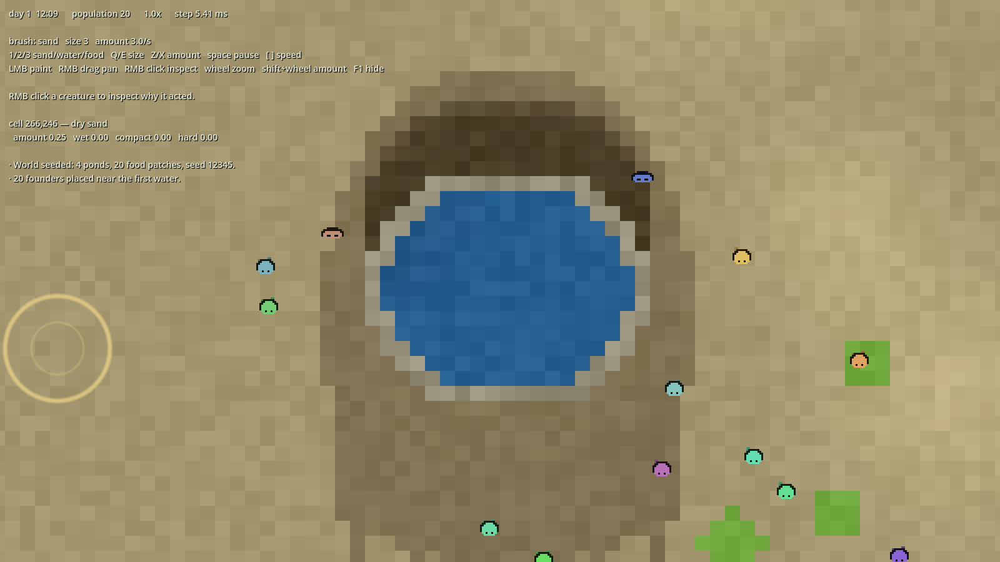

# Emergent Creatures — Phase 2 legibility and balance

A 2D sprite ecology where every creature is individually distinct and the player
does exactly three things: place sand, place water, place food. This repository
holds the **Phase 0 toy world** from
[emergent-creature-simulation-development-plan.md](emergent-creature-simulation-development-plan.md),
then the **material simulation**, then the **genome, life cycle and
reproduction** slice, then **place memory and the one learning rule**, then a
**search fix for the population decline**, then **food regrowth, observational learning and a search rebalance**, then a
**sparse opinion system with the socialise and avoid verbs**, then a
**carrying, piling and comfort slice**, a **safety and flee slice**, a
**sharing and harm slice**, and now the **Phase 2 legibility and balance pass**:
creatures are born with inherited parameters, grow up, breed only when fed and
rested, remember where they ate and drank, learn from what happened, watch
others feed and copy the place imperfectly, leave a patch to search when a need
cannot be seen or remembered, keep a short ledger of who fed them and who took
a meal from them, share a carried meal with a hungry companion, injure a rival
over a contested meal, seek company when lonely, keep away from a rival, run
when a remembered enemy comes close, recover their nerve in a sheltered corner,
pick up wet sand or surplus food and carry it, pile it where the ground is poor
and dry, rest on their own compacted heaps, prefer the hard, dry ground that
results, and die of hunger, thirst, poison, injury or old age. The Phase 2 layer
makes those stories visible: first-time detectors flash and log the first hard
ground, shelter, stockpile and rivalry; the history panel shows lineages,
places and firsts; creatures draw at their body size, desaturate with hunger,
slow with exhaustion, darken when wet and carry a visible load; terrain shows
wet, dry, hard, piled and recently contested ground.



## What exists

### The toy (Phase 0)

- **World:** 512 × 384 cell grid in 64 × 64 chunks, four materials (air, sand,
  water, food) with per-cell amount and nutrition, and derived wet sand, mud and
  hard sand computed from properties rather than stored as materials.
- **Creatures:** founders stored as structure-of-arrays columns, stable integer
  ids, free-slot reuse on death, and children born into the same arrays.
- **Needs:** hunger, thirst, energy, social and comfort, plus health; the first
  five each have a response curve that is flat when satisfied and steep when
  critical, shaped by the creature's own genes. No priority ladder.
- **Brain:** utility scoring over thirteen generic verbs — wander, move to,
  seek, eat, drink, rest, approach, mate, socialise, avoid, pick up, pile,
  flee — with softmax sampling from the top four and a commitment bonus.
- **Perception:** a spatial hash for neighbours, banded resource sampling
  (1-cell lattice near, 2-cell mid, 3-cell far) inside a sensory radius that is
  inherited (4–18 cells after body scaling).
- **Rendering:** cached terrain chunk textures plus one `MultiMeshInstance2D`
  per chunk; one procedural 8-frame atlas, one shader, per-instance tint and
  hunger desaturation. Never one node per creature.
- **Interface:** placement brush (material, size, amount), camera pan and zoom,
  pause and speed controls, and a read-only inspector showing the selected
  creature's verbs, need urgencies, and scored candidates with their components.
- **Log:** deaths and world events, shown in the HUD and readable headless.

### Materials (Phase 1, first slice)

- **Flow:** liquids fall, slide, and level; free water moves whole cells and
  only into open space or other water.
- **Wetness:** water soaks into sand and food as wetness and drains downward.
  Water above a cell's field capacity moves on; the film below it is held and
  only dries. Hard sand refuses water entirely through its face.
- **Drying:** exposed wet material evaporates; deeper material dries more
  slowly. Water surfaces evaporate too, so ponds are a finite resource.
- **Compaction:** weight above compacts sand up to a cap, and a resting creature
  compacts the ground under it several times faster than walking does.
- **Hardening and softening:** wetness *history* × compaction × drying turns sand
  into hard sand, which resists floods. Wetting hard sand past mud level softens
  it again. That is the whole wet-sand chain: soak it, compact it, dry it, and it
  becomes hard; flood it and it comes back.
- **Rotting:** food loses nutrition faster when wet, and past a threshold becomes
  toxic; eating it costs health. The tuned rate leaves food edible for about
  five days, so a session can outlast the food supply rather than be poisoned by
  it on day two.
- **Performance model:** flow runs at 5 Hz on a maintained list of water cells;
  wetness, compaction, hardening and rot run every material tick on a FIFO queue
  of cells that are still changing, in batches of 400. Each cell carries its own
  material clock, so a bounded batch makes the integration step coarser, never
  the rates slower or faster. Rot visits the food-cell list, not whole chunks.

Ponds start on a **hard-sand pan** (the sand touching pond water begins hard).
Without it a pond in loose sand drains away in minutes; the pan is the material
system's own answer to an impermeable bed, and flooding it softens it.

### Genome, life cycle and reproduction (Phase 1, second slice)

- **Genome:** 19 floating-point loci per creature — size, speed, sense radius,
  metabolism, three need setpoints, stomach, four response-curve exponents
  (hunger, thirst, energy, safety), boldness, curiosity, hue, imitation
  fidelity, sociality, aggression and conscientiousness. Every locus is read by
  a live system today; no gene sits in the vector doing nothing.
- **Body budget:** size, speed, sense and stomach share a budget below their
  maximums, so a mutation that pushes one up pulls the others down at decode
  time. Metabolism then carries the running cost: a bigger body is hungrier.
- **Inheritance:** each locus is taken from one parent, then mutated (2% per
  locus, 5% of range; 0.1% large jumps of 25%). Mutation count, both parents,
  generation and founder line are recorded on the child.
- **Life cycle:** children are smaller and slower through one body scale; adults
  breed, and a healthy old creature remains eligible for the same gate, so adult
  and old cohorts can overlap. The old decline through the same scale and lose
  health until age kills them. Stage is one column, not a behaviour set.
- **Reproduction gate:** past maturity, off cooldown, healthy, fed, watered and
  rested — and the partner must pass the same gate at the moment of contact.
  Close kin are refused; compatible pairs must be far enough apart genetically.
  The same gate serves every creature; there is no breeding season.
- **Birth spacing:** each birth leaves a 0.65-day base cooldown with ±0.05-day
  independent jitter for each parent. A sweep from 0.4 to 0.9 days changes the
  boom but not the eventual extinction (see below).
- **Mating behaviour:** the brain scores approach when a willing partner is in
  sensory range and mate when in contact. Neither verb can bypass the gate: it
  lives in the simulation, not the brain.
- **Lineage in the log and inspector:** births name both parents, generation,
  mutations and place; the HUD shows stage, generation, offspring, founder line
  and the creature's genes.

### Memory, learning and search (Phase 1, third slice)

- **Place memory:** eating and drinking record the cell, its material and the
  standing value, up to eight places. A hungry or thirsty creature that can see
  nothing of the needed kind scores the best remembered cell, discounted by age
  (confidence halves every two days) and distance. The distance discount falls
  off over 24 cells (`memory.recall_distance_cells`); normalising it by the
  sensory radius saturated past the edge of sight, so a meal seven cells away
  and one forty cells away cost the same and recall competed evenly with idle
  wandering. Finding a remembered place empty forgets it.
- **Episodic memory:** a 32-record ring of verb, context, stress, need before
  and after, cell and day. A full ring evicts the record with the weakest
  stress-weighted recency, so a near-critical episode survives longer than a
  calm one. Nothing is inherited; a reused id starts blank.
- **The one learning rule:** after eat, drink or rest, `weight += rate × stress ×
  (actual improvement − weight)`. The weight multiplies that verb's score in the
  same context by 0.4–1.6. Routine success converges and teaches little; a
  high-stress rescue teaches several times more. Only verbs that change a need
  directly update weights, because mean need always drifts down while seeking.
- **Delayed evaluation:** eating arms a re-check one second later. Rotten food
  leaves a toxin load that outlives the meal and drains health until cleared, and
  the gain becomes a negative weight for eating in that context — one bad meal
  is felt after the hunger need has already risen.
- **Inspector:** the HUD shows the selected creature's place and episode counts,
  its strongest lesson, and its last episode with stress and need change.
- **Search when nothing is in sight:** a creature that can neither see nor
  remember the resource it needs picks a direction and commits to a **48-cell
  leg**, turning only 0.35 rad from the last chosen direction. A wander leg is
  held until its target is reached rather than re-rolled every 1.2 s, so
  successive legs actually cover ground. This is the answer to "starving beside
  food": creatures were orbiting a patch three cells at a time.

### Food regrowth, imitation and search balance (Phase 1, fourth slice)

- **Food regrows in place**, at 0.12 cell mass per day, and only where food
  already is: growth never appears on bare ground, so the starting patches stay
  the map of where food can be. New tissue has full nutrition and no toxin and
  dilutes both in proportion to the mass it adds. A cell eaten to the floor
  keeps a 0.02 **living trace** that cannot be eaten; without it the cell became
  air and the patch could never grow back.
- **Standing water seeps back toward capacity**, logistically: gain = rate ×
  (a/cap) × (1 − a/cap) at `water_regrow_per_day` 0.15. A pond refills the holes
  drinking left in it; one drunk down to a puddle recovers only a trickle, which
  is what keeps the drought scenario honest. Without this rule a world has no
  water cycle at all, so any no-input run ends in extinction by arithmetic — a
  thirty-day soak could not pass whatever the creatures did. Ponds now hold
  (1,012–1,212 cells through day 8–10 on the three test seeds) where the
  water-poor seed used to lose 9% of its water a day.
- **Imitation is observational, not teaching.** Everyone within 9 cells of a
  creature that eats or drinks copies the place — cell, material and standing
  value, so context travels with the location — scaled by the observer's
  **imitation-fidelity gene**, a linear distance falloff, and youth (×1.4 as a
  child, ×0.8 old). Copy fraction 0.5 keeps every copy below firsthand value
  (0.7 for a child at the teacher's side, 0.5 for an adult); a copy is refreshed
  at most once per second per teacher and never overwrites a place the observer
  knows better.
- **Search balance:** food and water search are separate candidates — food from
  0.35 urgency at weight 0.7, water from 0.15 at weight 1.1 — because a missed
  pond can be fatal while food regrows nearby. Rest now yields to hunger and
  thirst by 0.8 × the stronger urgency; at water zero a nap is no longer
  competitive with walking to a known pond, which was killing creatures that had
  already drunk sixteen times.

### Social opinion, socialise and avoid (Phase 1, fifth slice)

- **A social need, not a social script.** It falls at 0.9/day, is restored by
  company, and never kills: isolation removes social actions from reach rather
  than damaging health. It sits outside the distress that makes decisions
  erratic.
- **Opinion is sparse, asymmetric and decayed.** Each creature keeps at most 16
  remembered relationships, each with signed valence, last day and event count;
  a full store evicts the weakest decayed record. A's opinion of B is not B's
  opinion of A. Valence halves every three days, so a feud cools when the
  creatures stop meeting and has to be rekindled by new events.
- **Kinship is computed, not stored.** Parents, children and siblings get a
  +0.30 starting bonus read from lineage at encounter time; no memory slot is
  spent and no entry can go stale.
- **Events carry their context.** Socialising raises both sides' opinions by a
  gain scaled by each side's own loneliness and sociality, so the same meeting
  is worth more to the lonelier creature. Mating adds +0.12 to both. Eating from
  a **depleted** cell that a hungry neighbour was about to take records a
  grievance for that neighbour only; a bite from an abundant cell records
  nothing, and a well-fed bystander has no grievance. Taking the last food from
  a hungry creature is a betrayal; taking from a full pile is housekeeping.
- **The brain reads opinion at encounter time.** Socialise is available within
  2.5 cells and scores with the social need, the creature's sociality gene and
  how much it values the other. Approach closes distance to a visible friend, or
  to a stranger when loneliness is high. Avoid is offered only for a creature
  whose opinion is below -0.25, only within 4.5 cells, and is discounted by
  boldness. Aggression raises the score of a meal contested by a disliked
  creature. No branch reads "friend" or "rival".
- **Labels are for the player.** The inspector names a relationship friend above
  +0.30 and rival below -0.20, but only after three events; the brain never
  reads those names.
- **Two new genome loci:** sociality (15) and aggression (16). Sociality weights
  the social need and social actions; aggression weights contested meals.
  Neither unlocks an action.

### Carrying, piling and comfort (Phase 1, sixth slice)

- **Pick up and pile are generic material verbs, not an item system.** A
  creature holds one material and an amount; the load keeps the source cell's
  wetness, nutrition and toxicity. Picking up removes material from a cell;
  piling adds it to another. Food keeps its living trace, so carrying cannot
  strip a patch below the amount that lets it regrow. Water is not carried:
  there is no container material, and that is the general fix when it arrives.
- **Capacity is a body property, and a load has a cost.** Capacity is
  `1.4 + 2.6 × size` in material mass, so a large body hauls more. A sand load
  at density 2.2 costs up to 40% of movement speed; a food load costs less for
  the same volume. The carried material is drawn as a small blob above the
  body, coloured by material and sized by amount, in the same instanced pass as
  the creature.
- **Food is stored only out of surplus.** Pick up is offered when the creature
  is above 0.55 food and standing beside a food cell; a hungry creature eats
  instead. Pile values food away from a patch more than food on top of one, so
  carrying a meal out of a rich patch to open ground is the physical origin of
  a cache. The cache is just a food cell; nothing tracks ownership.
- **Critical thirst overrides pick-up.** Pick up is not offered once thirst
  urgency reaches 0.60; a parched creature spends its next commitment on water,
  not on another load. Pile stays available, so a carrier can shed a load and
  its speed penalty on the way to water. The threshold is a need gate, not a
  ban on finishing a useful trip.
- **Sand is picked up when comfort is low and the ground is poor.** Wet sand is
  preferred because it is cohesive, which is how the wet half of the hardening
  chain enters a load without the creature knowing chemistry. Pile scores only
  cells that can take the load: soft, dry and not already full. Piling onto a
  hard or full cell improves nothing and scores accordingly.
- **Comfort is a need, and it never damages health.** It falls at 0.55/day,
  faster when the creature is wet or standing in water. Resting on dry, hard,
  compacted ground restores it at up to 2.2/day; resting in mud restores almost
  nothing. The comfort affordance of a cell is computed from hardness,
  compaction and wetness at query time — no cell is tagged “shelter”.
- **Comfort seeking is a property read.** A low-comfort creature whose ground is
  poor scans a ten-cell neighbourhood for a better cell, caches the target, and
  re-scans about every 2.4 seconds. Rest scores higher on good ground, because
  that is where rest actually restores comfort. The scan is why comfort can
  pull a creature across the map without a place label.
- **The shelter chain is reachable end to end.** Wet sand → picked up → piled →
  a creature rests on the pile → resting compacts it → it dries → hardness and
  cohesion rise → the cell's comfort affordance rises → the creature prefers to
  rest there. The suite walks every step and asserts the hard-sand state and the
  comfort affordance that follows; a soak shows the loads moving, but there is
  no creature-built-structure detector yet.
- **A cache meal teaches storing.** When a creature eats from a food cell it
  piled no more than a day earlier, the delayed half of the same learning rule
  credits the pile and the pick-up that supplied it. The context and stress are
  the ones at piling time, so a cache made after a near-starvation teaches far
  more than one made while comfortable. The cache cell is an outcome record,
  never a branch the brain reads.
- **A death drops the load.** Whatever the creature carried falls into the cell
  where it died, if that cell can take it. Losing the rest is honest.
- **Conscientiousness (locus 17)** weights the store verbs. It raises the score
  of pick-up and pile; it never triggers storing by itself. Carrying adds one
  material-accounting pass, one neighbour pick-up scan and a cached comfort
  scan, not a per-cell sweep.

### Safety, fear and flee (Phase 1, seventh slice)

- **Safety is the last of the plan's survival needs to get a state and a
  verb.** It starts full, falls when a creature this one has come to dislike is
  close, and falls slowly when its position is exposed. Resting in a protected
  arrangement restores it. It never damages health: it changes where a creature
  goes and whether it can sit still, not how long it lives.
- **Protection is arrangement, not a tag.** `protection_quality` reads the
  hardness and cohesion underfoot plus the share of the surrounding eight cells
  that are hard. A lone hardened patch is weak cover (0.36), a ring of hard
  cells is strong cover (0.96), open sand is 0.00 and water is 0.00. The same
  cell therefore serves comfort and safety without being called a shelter.
- **Threats are remembered people, not a predator species.** The need walks the
  creature's own opinion store (at most sixteen entries): any negative opinion
  within 12 cells becomes a threat, weighted by distance and relative body
  size. A stranger is not a threat, and a fresh world has no fear in it until
  creatures have actually wronged each other. As opinion decays, a cooled feud
  stops being frightening without a separate rule.
- **Flee is one of the thirteen generic verbs.** It is offered when safety
  urgency passes 0.15 and a remembered enemy is within 9 cells, aims at a
  retreat point away from the threat, moves at 1.4× speed and ends at 9 cells. Boldness discounts
  the score. Once safety urgency crosses 0.70, flee interrupts any other choice
  while a threat is in reach — the plan's one priority-like rule, owned by the
  curve rather than by a ladder of needs. Avoid remains the mild response for
  opinion below −0.25; flee is the urgent one.
- **Fear is learned with the same one rule.** Acute fear is its own context.
  When a flee bout ends, `weight += rate × stress × (safety after − safety
  before)` updates the flee weight in the afraid context: a retreat that
  restored safety teaches that fleeing works, one that did not teaches
  otherwise. Fear is not inherited; a newborn starts at full safety.
- **The inspector shows the cause.** The HUD adds the safety deficit, the
  hovered cell's protection affordance, and the selected creature's current
  threat (id, opinion, distance, strength). A frightened flee bout writes a
  `safety` log line naming the threat, the safety level and the opinion that
  produced it; the line is throttled to one per creature per 24 simulated
  seconds so ordinary retreats cannot push deaths and births out of the ring.
- **Ablation:** `--no-safety` freezes the need and removes the flee candidate,
  so the disable-one-system test can compare the same seed.
- **Through the real tick:** a 10-minute watch on seed 101 ends at 30 alive and
  0 deaths; 5-minute watches on 202 and 303 end at 29 each and 0 deaths. A
  one-day seed-202 soak produced only four food disputes and no flee; two days
  on the same seed produced 116 food disputes, 24 opinions and **1,839 flee
  bouts** (before sharing and harm; the current build produces 3,934), so fear
  is a slow accumulation, not an opening-minute event. The same-seed A/B is in
  the criteria table below.

### Sharing and harm (Phase 1, eighth slice)

- **Two social events, no new verb.** The plan's vocabulary stays at thirteen:
  a share rides `socialise`, and an injury rides the food contest that already
  records a grievance. Both write through the existing opinion store, event
  log, metrics and safety need.
- **One home per event.** Sharing lives in `sim/share.gd`, harm in `sim/harm.gd`,
  safety and flee in `sim/safety.gd`, and the fixed tick order in `sim/tick.gd`.
  Each unit owns its counters, cooldowns and log writes; `sim/sim.gd` keeps the
  world, the creatures and the actions around them.
- **A share is a real transfer, not a gesture.** The giver must be carrying
  food, be above its own surplus line (food ≥ 0.55), and hold at least 0.15.
  The recipient must be hungry (≤ 0.60), and neither side may dislike the other
  (opinion ≥ −0.05). The candidate's score rises with recipient hunger, giver
  surplus, sociality and existing affinity, so sharing is a confluence of
  circumstances, not an altruism rule. A per-giver cooldown (0.10 day) stops
  one exchange emptying a load. The meal moves: the giver's `carry_amount`
  falls, the recipient's food rises by mass × nutrition × the 1.4 relief rate,
  the recipient thanks the giver in proportion to how hungry it was, and the
  giver remembers the act at half weight.
- **Harm is the contested meal read one step further.** `_contest_food` already
  records who lost a bite and how scarce it was. If the winner is aggressive
  (>0.60), at least as large as the loser (>0.95), does not like it (>0.05),
  and the loser is vulnerable (health ≤0.60 or food ≤0.55), the same event
  injures: health falls by roughly 0.08 scaled by size and scarcity, safety
  takes a 0.35 shock, the victim records −0.45 and the attacker −0.08. The
  per-pair dispute cooldown (0.05 day) rate-limits it, and a lethal injury
  records `harm` as the death cause rather than starvation.
- **Fear now has something to point at.** The shock and the new negative
  opinion feed the existing threat scan, so an injured creature can choose
  flee on its next decision. With safety disabled, the injury and memory still
  occur but the shock and flight do not.
- **Log and HUD are unchanged paths.** One `social` line per share and one
  `harm` line per injury, both bounded by their event cooldowns; the HUD's
  recent-events panel shows them, the inspector shows the changed opinion and
  safety numbers, and the soak prints shares, harms and harm deaths next to
  the other social counters. The 2-day run kept **3 share and 6 harm lines**
  in a 134-of-256 log, so neither event floods the ring.
- **Through the real tick:** the focused tests drive a share and an injury
  through `step()`, including a dispute-to-flee sequence; the same-seed 2-day
  soak produced **3 shares and 6 harms** with 209 food disputes and 32 alive,
  so both occur outside the fixture. The natural-run log composition is in the
  tuning register.

### Move to, the thirteenth verb (Phase 1, vocabulary completion)

- **Travel to a chosen place is now its own verb.** The plan's vocabulary has
  thirteen actions; the code had twelve, and travel to a remembered meal or pond
  was reported as `seek`. `seek` is for a resource the creature can currently
  perceive; `move_to` is the plan's "travel toward a remembered or perceived
  target cell", chosen here for a remembered place. The decision label keeps the
  lead (`recall_food`, `recall_water`), so the soak's recall count and the
  memory story are unchanged.
- **It is the same body, named honestly.** Move-to shares the seek movement and
  commitment (2.0 s), so no score, route or balance figure changes by design.
  What changes is what the action mix and the inspector call the action: travel
  is visible on its own, and `seek` means a perceived advertisement. The episode
  records `move_to`; like seek it does not teach a weight, because the mean need
  drifts down during travel and the eat or drink that follows carries the
  credit.
- **Through the real tick:** a hungry creature whose only lead is a remembered
  cell chooses `recall_food` with the `move_to` verb; 45 steps record move-to
  decisions and close the distance. A visible meal still chooses `seek_food`
  with `seek`, and the table holds all thirteen names. The renderer falls
  through to the walking frames, so the new verb needs no new art.

### Legibility and balance (Phase 2)

- **First-time detectors, not narration.** `sim/detectors.gd` notices the first
  hardened pile, the first rest on ground a creature made hard, the first
  creature-piled food stockpile above six cells, and the first opinion that
  crosses the rival label. Each writes one causal log line, pulses a ring at the
  place for twelve seconds, and stores the first in a permanent list. There is
  no story card and no camera takeover; the player keeps control.
- **Lineage, history and place views.** `H` opens the world history panel. Each
  lineage row keeps its founder, live/extinct counts, births, deaths, generation,
  geographic spread, genome drift, oldest member and a population series sampled
  every half-day. Places list completed shelters and caches with builder, user,
  hardness or cache age, and the disputes and injuries recorded at that cell.
  A contested place with no structure appears in the same list. The same records
  feed the inspector's opinion chain and place outcomes.
- **Visual state language.** Creature instances draw at the body-size gene times
  the age scale, so a child, a small adult and a large old adult are different
  silhouettes from one sprite. Hunger desaturates, exhaustion slows the walk
  cadence, ground wetness darkens, and a carried load is a material-coloured
  blob sized by amount. Terrain shows wet/dry sand, hard pans, pile amount,
  rot/toxicity and a red heat that fades after a dispute. Appearance genes are
  still only hue; the plan's pattern layer is not built.
- **Carrying capacity and scarcity.** The current pass has six ponds, water
  search at 0.10 urgency with 64-cell legs, a 20-cell mate search, lower food
  regrowth (0.05/day), slower generations (1.50-day cooldown, 0.50-day
  maturity), and a longer overlapping old stage (8 days, 0.45 health/day
  decline). On three seeds × three days the peak is 29–30 and the end is 21–26,
  with 10–14 births, 6–9 deaths and diversity 0.399–0.404. The old boom is gone;
  whether the curve oscillates or slowly declines is a ten-day/30-day question,
  not a three-day one.
- **Soak and disasters.** `tools/phase2_soak.gd` is the plan's ten-seed,
  thirty-day no-input suite with population, cause-of-death, diversity,
  oscillation and peak gates. `tools/phase2_disasters.gd` runs the drought,
  feast-then-famine and flood-the-shelter placement scenarios. Both drive the
  real fixed tick; a disaster changes starting conditions and placement only.

Deliberately deferred: the practice detector, spread overlay and territory tint
belong to Phase 4; dominance as an interface feature and all new simulation
systems are out of Phase 2 scope. Seasons, predators, water carrying and player
powers beyond the three brushes remain absent. Imitation copies places, not
action sequences; memory retrieval still biases current action weights rather
than replaying an episode. Pattern genes are not implemented, only hue.

## Running

```bash
godot --path .                      # play
```

Controls:

| Input | Effect |
|---|---|
| `1` / `2` / `3` | sand / water / food brush |
| `Q` / `E` | brush radius down / up |
| `Z` / `X` or shift+wheel | placement amount down / up |
| Left mouse drag | paint with the current brush |
| Right mouse drag | pan |
| Right mouse click | inspect the creature under the pointer |
| Wheel | zoom |
| Space | pause |
| `[` / `]` | simulation speed |
| `Esc` | clear selection |
| `F1` | hide/show the HUD |

Load a different world:

```bash
godot --path . -- --seed=202
```

### Seeing the materials

- Pour a **thin** brush of water on dry sand: it darkens, then dries back over
  roughly a day.
- Pour water onto a **pond pan**: it pools on the hard sand instead of vanishing.
- Select a creature, let it **rest** on damp ground for a few seconds, then watch
  the cell lighten toward hard sand as it dries.
- Hover a cell: the HUD names its derived state (dry sand, wet sand, mud, hard
  sand, rotting food) and shows amount, wetness, compaction and hardness.

## Verification

```bash
# 357 checks: curves, grid, flow, wetness, hardening chain, rot, water
# bookkeeping, food regrowth and its living trace, genome decode and
# inheritance, reproduction gate, old fertility, birth spacing, old age,
# place memory and recall, the
# learning rule and toxin lesson, imitation of places, the opinion store and
# social events, socialise/approach/avoid choices, protection affordances,
# safety decay and recovery, flee choice and interrupt, fear learning,
# sharing and harm gates, transfers, memories and real-tick flight,
# carrying and piling, comfort affordances and the wet-sand shelter chain,
# cache learning, search legs, determinism, no-stacking, exit criteria,
# phase 1 shelter/storing/rivalry stories with their one-system-off ablations,
# inspector opinion chains and place outcomes, benchmark
godot --headless --path . --script res://tools/run_tests.gd
# (the 10 ms performance gate can fail on a loaded desktop; functional checks are independent)
# The Phase 1 stories are in sim/tests/phase1_stories.gd; each runs through
# Sim.step and is paired with an ablation from sim/tests/story_harness.gd.

# Phase 2 first-time detectors, lineage/place history, lineage series and contests
godot --headless --path . --script res://tools/phase2_check.gd

# The plan's ten-seed, thirty-day no-input soak. Run seeds in parallel and merge:
#   godot ... phase2_soak.gd -- --days=30 --seed=101 --out=/tmp/soak/101.json
#   godot ... phase2_soak.gd -- --merge-dir=/tmp/soak --out=docs/phase2-soak.json
godot --headless --path . --script res://tools/phase2_soak.gd -- --days=30

# The three placement disasters: drought, feast then famine, flood the shelter
godot --headless --path . --script res://tools/phase2_disasters.gd -- --scenario=all

# ten seeds, no player input, 3 simulated days each (births and generations)
godot --headless --path . --script res://tools/phase0_soak.gd -- --days=3

# a shorter run while iterating (first three seeds)
godot --headless --path . --script res://tools/phase0_soak.gd -- --days=3 --seeds=3

# the same soak with place memory and learning disabled, for an A/B
godot --headless --path . --script res://tools/phase0_soak.gd -- --days=3 --seeds=3 --no-memory

# search candidates off, keeping the long walk legs: isolates the search fix
godot --headless --path . --script res://tools/phase0_soak.gd -- --days=3 --seeds=3 --no-search

# social verbs and opinion events off, for a same-seed A/B
godot --headless --path . --script res://tools/phase0_soak.gd -- --days=3 --seed=202 --no-social

# pick up and pile off, keeping the comfort need and everything else
godot --headless --path . --script res://tools/phase0_soak.gd -- --days=3 --seed=202 --no-carry

# safety need and flee off, freezing safety at its starting value
godot --headless --path . --script res://tools/phase0_soak.gd -- --days=3 --seed=202 --no-safety

# one seed while iterating (303 is the water-poor case)
godot --headless --path . --script res://tools/phase0_soak.gd -- --days=5 --seed=303

# visual capture, including one simulated brush stroke through the real input path
godot --path . res://tools/capture.tscn -- --frames=160 --zoom=3 --paint=water --out=/tmp/shot.png
```

`tools/run_tests.gd` exits non-zero on failure, so it is usable as a CI gate.

## Phase 0 exit criteria

| Criterion | Evidence |
|---|---|
| Creatures eat, drink, rest and wander | all five core verbs occur in every seed; the pre-move-to 3-day mix was wander 41–55%, rest 22–27%, seek 12–14%, eat 6–15%, drink 2–6%. After the split, the one-day seed-202 run is wander 56%, move_to 1%, seek 5%, eat 11%, drink 5%, rest 22%. Socialise and avoid have their own section |
| Do not instantly die | no deaths in the first 1.25 days of every seed; over 3 days the population settles at 18–34 after breeding (see below) |
| Do not freeze | every creature's travelled path > 2 cells in a two-minute run; no creature is stationary unless resting |
| Do not stack on one cell | max 2 creatures per cell, mean occupancy 1.00 cells per creature over a two-minute run |
| Worth watching | creatures are visible and individually identified at 20; walk, eat, drink and rest frames differ; the world is deterministic and never stalls. A full ten-minute human watch is still a playtest item, not something a headless suite can certify |
| Same seed reproduces the world | identical state hash after 300 steps with identical placement input; different seed differs |

## Materials criteria (this slice)

| Claim | Evidence |
|---|---|
| Water flows and pools | falls into open space, spreads sideways when blocked, never stacks without a water cell; asserted |
| Wetness transfers and dries | drains down above field capacity, holds below it, dries over days; asserted at both rates |
| Compaction comes from resting | a resting creature reaches the hardening threshold in seconds; asserted |
| Hardening needs all three | wet + compacted + dried sand hardens to 0.70; kept wet it stays mud; dried loose sand stays loose; compacted dry sand never hardens; asserted |
| Floods soften hard sand | a flooded hard cell loses hardness, and a hard face refuses water while hard; asserted |
| Rot is wet-dependent and toxic | wet food rots faster than dry, toxicity damages a creature that eats it; asserted |
| Hard pans hold ponds | water sits on a pan, no wetness crosses it from above or below; asserted |
| Cost stays bounded | 400-cell batch processes exactly its budget and leaves the rest queued; 0.8 ms material step on a 96-cell pond; 4.3 ms/step at 20 creatures |

## Genome and reproduction criteria (this slice)

| Claim | Evidence |
|---|---|
| Genomes inherit and mutate | with mutation off, every locus equals one parent's; with a rate of one, every locus mutates; asserted |
| Body trade-offs are real | an all-max size/speed/sense/stomach genome decodes to the 0.72 budget with its cost genes scaled back; asserted |
| Breeding is gated | two fed, rested adults in contact conceive; children, cooling-down parents and parent-child pairs are refused; asserted |
| Lineage is recorded | the child stores both parents, generation, founder line and mutation count, and the birth is logged |
| Age kills | an old creature declines and dies with the old-age cause; asserted |
| The population changes over days | 3-day soak, 3 seeds: 20 founders → 28–33 peak → **22 / 33 / 19 alive**, 10 / 23 / 9 births, max generation 2 / 7 / 1, 28 deaths total |

Materials in that soak, 3 seeds × 3 simulated days: water 309–659 cells, damp
sand 215–557, mud 71–93, hard sand 298–481, food 297–416, rotten food 0. Food
now regrows, so those counts are a standing crop rather than a shrinking larder.
The faster rot of the first tuning turned every food cell toxic by day 2 and
killed the population by poison; the rate is now 0.10/day, which still rots food
over days but leaves it edible within a session.

## Memory and learning criteria (this slice)

| Claim | Evidence |
|---|---|
| Places are remembered | eating and drinking record the cell, its material and how much was there; a hungry creature with nothing in sight recalls it and moves to it with the `move_to` verb; asserted |
| Memory fades | confidence halves every `memory.place_decay_days`; a forgotten cell is never returned; a creature that finds a remembered cell empty drops it; asserted |
| Memory is bounded | 8 places and 32 episodes per creature; a full place store evicts the weakest decayed record; high-stress episodes survive eviction longer; asserted |
| Learning follows the outcome | `weight += rate × stress × (actual − weight)`; one update moves toward the improvement, repeated success converges, a negative outcome lowers the score; asserted |
| Stress is what consolidates | the same improvement teaches **4×** more at stress 1.0 than at stress 0.2; asserted |
| Context is the pressing need | the dominant need (hunger, thirst, energy) is the context even when mild; content is reserved for a creature with nothing above 0.05 distress |
| Rotten food leaves a toxin load | eating toxicity adds to a body load that outlives the meal and drains health until cleared at 3/day; asserted |
| Slow harm still teaches | a delayed re-check after eating turns a toxin gain into a negative weight for eating in that state, even though the meal raised hunger immediately; asserted |
| Memory is not inherited | a reused id starts blank and siblings share no learning; asserted |
| Memory changes survival, modestly | on the pre-search code, same seeds, memory on vs off: **14.7 vs 13.7 mean alive**, 45 vs 51 deaths. One seed ends lower with memory on, so this is a small shift, not a rescue |

## Search criteria (search fix)

| Claim | Evidence |
|---|---|
| Search is blind only when it should be | a thirsty creature with no water in sight or memory gets a `search_water` candidate aimed ~48 cells away; with water in sight it becomes a seek, and with a water memory it becomes a move-to; asserted |
| A search leg is actually walked | a 20-cell wander leg commits for 11.1 s (distance / speed, minimum 1.2 s), so the destination is not re-rolled after three cells; asserted |
| Search addressed the first decline (pre-regrowth code) | 3-day soak, 3 seeds: **20.0 mean alive** with search (26/15/19) against **12.7 with search off** on the same code (19/9/10) and 14.7 on the pre-fix code. Deaths 29 vs 52 vs 45. Seed 101 ends at 26 instead of 19 |
| It was discovery, not supply, that the first fix addressed | deaths on seed 202 were creatures that had **never drunk**: 5–8 food places, zero water places, water 21–88 cells away. Search cut its dehydration deaths from 11 on the same code (9 before the fix) to 6 |
| Regrowth moved the long-run ceiling (historical, pre-store build) | on the pre-regrowth code a 5-day run on seed 101 ended at **0 alive**; with regrowth it ended at **17**, 14 deaths (4 old age), 11 births, food 297 and water 599 at day 5. A later ten-day run still goes extinct once the cohort ages out |

## Regrowth, imitation and balance criteria (this slice)

| Claim | Evidence |
|---|---|
| Food regrows in place | a grazed cell gains mass over 480 s, its nutrition rises and its toxin falls; growth stops at the cell's capacity; asserted |
| A grazed patch survives | eating a 0.03 cell leaves a 0.02 uneatable trace, a second bite takes 0, and the trace regrows into edible food; asserted |
| Watching a meal teaches the place | child and adult observers 2 cells from a drinker learn it; the drinker does not; an observer with zero fidelity, or beyond 9 cells, learns nothing; asserted |
| Copies are weaker, and younger copies stronger | child copy > adult copy, both < 1.0 firsthand value; a weak copy never overwrites firsthand knowledge; asserted |
| Teaching is rate-limited | a second lesson within one second is ignored; after two seconds a second place is stored; asserted |
| Regrowth ended the starvation cliff (historical, pre-store build) | 5-day soak, seed 101: **17 alive** (0 before regrowth), 11 births, 14 deaths, 16 of 17 old; food 297 and water 599 at day 5. It did not remove the later old-age extinction |
| The rebalance is neutral in aggregate | 3-day, 3 seeds before and after: mean alive **24.7 both**, deaths 29 → 28, births 43 → 42. Seed 303 gains 5 creatures (14 → 19), seed 202 loses 4 thirst deaths (7 → 3), seed 101 gives up 5 (27 → 22) with 8 deaths against 5 |
| The remaining thirst is supply | seed 303 starts with 420 water cells and ends day 3 at 309 with 554 wet cells; 9 dehydration deaths, mean water 0.08. The ponds are drunk dry; search cannot find water that is no longer there |

## Social criteria (this slice)

| Claim | Evidence |
|---|---|
| Opinion is sparse and asymmetric | sixteen slots; an event moves one side only; a strong relationship survives eviction of weaker ones; asserted |
| Opinion decays | a +0.50 opinion is +0.25 after three days, the configured half-life; asserted |
| Kinship is a starting condition | a parent and child count as related and start at +0.30 with no event; asserted |
| Socialising is mutual, contextual and rate-limited | one exchange raises both opinions and both social levels; a second exchange inside the 20 s cooldown is blocked and happens after it; asserted |
| Company is chosen from opinion | lonely beside a friend: socialise 60/60; a visible friend: approach 60/60; beside a disliked creature: avoid 60/60, and the avoid action increases distance |
| Aggression reads through a contested meal | same food, same opinion: eat score **0.88 calm vs 1.19 aggressive**; asserted |
| Context makes the grievance | a depleted cell taken in front of a hungry neighbour records **−0.14**; the same bite from a full cell records **0**; a per-pair cooldown stops one meal becoming many events |
| Rivalry is a pattern, not a flag | three negative events produce a rival bond in the metrics; the brain has no branch that reads a label; asserted |
| Social changes outcomes, unevenly | same-seed 3-day A/B: 101 **27 vs 27** alive, 202 **34 vs 22**, 303 **18 vs 22**; mean 26.3 vs 23.7, deaths 20 vs 21, births 39 vs 32. One seed gains 12, one loses 4, one is flat, so the mean is directional, not proof |
| Social has a cost | 3-day mean step **8.6–10.9 ms** at 18–34 alive, against 7.9–8.3 ms with social off on the same seeds; the social pass is one neighbour query per creature per decision tick |

## Safety and flee criteria (this slice)

| Claim | Evidence |
|---|---|
| Protection is arrangement | a lone hard cell scores 0.36; a ring of hard cells 0.96; open sand 0.00; water 0.00; asserted |
| Safety falls beside a remembered enemy, not a stranger | 200 ticks beside a −0.70 opinion: 1.00 → 0.82; the same pair with no opinion stays at 1.00; asserted |
| Safety recovers, fastest in cover | 3000 ticks from 0.40: open ground 0.46; resting in a hardened 3 × 3 1.00; asserted |
| Flee is chosen and aims away | safety 0.20, disliked neighbour 1.5 cells: flee 59/60, aim away 59/60; asserted |
| Boldness discounts flight | same threat at safety 0.45: flee score 0.45 timid vs 0.18 bold; asserted |
| Fear interrupts | hungry on food, safety 0.03: the eat candidate exists, the chosen verb is flee; context afraid; asserted |
| Flee runs through the real tick | 30 steps: 30 flee decisions, distance 1.50 → 6.98 cells, a `safety` log line naming the threat; asserted |
| The same rule teaches fear | a retreat from safety 0.10 to 0.60 teaches **+0.125** flee weight in the afraid context; the flee episode is recorded; asserted |
| No safety, no fear | with `safety_enabled = false`: no flee candidate, no flee decisions, safety 0.15 unchanged over 30 steps; asserted |
| Fear is not inherited | a newborn starts at safety 1.00 while both parents are at 0.10; asserted |
| The need fires in a real run, and changes behaviour without changing survival | same-seed 2-day A/B (202), safety on vs off: **24 vs 24 alive**, 10 vs 10 births, 6 vs 6 deaths, mean safety **0.57 vs 1.00**, **1,839 vs 0** flee bouts (2,586 flee decisions), 181 vs 1,635 avoid decisions, 6 vs 13 rival bonds, 116 vs 161 food disputes, 24 vs 33 opinion entries. Mean step 40.03 vs 39.89 ms on this host |

## Move-to criteria (this slice)

| Claim | Evidence |
|---|---|
| Move to is a distinct verb | a remembered meal is `recall_food` with the `move_to` verb; a visible meal is `seek_food` with `seek`; asserted |
| It executes, not just scores | 45 real ticks choose move-to and close the distance by more than 2 cells; asserted |
| The vocabulary is complete | 13 unique verb names including `move_to`; asserted |

## Sharing and harm criteria (this slice)

| Claim | Evidence |
|---|---|
| A share moves a real meal | one socialise exchange lowers the giver's load, raises the recipient's food, and is counted once; asserted |
| A share is remembered by both sides | the recipient's gratitude exceeds +0.15 and the giver's opinion rises; the recipient's opinion entry records at least two events; asserted |
| Sharing is rate-limited | an immediate second exchange transfers nothing; a per-giver 0.10-day clock is the gate; asserted |
| A share is a remembered, logged event | exactly one `social` line names the transfer, and the metrics count one share; asserted |
| Harm costs health and safety | a contested meal drops the victim's health and shocks safety (0.40 → 0.05 in the fixture); asserted |
| Harm is remembered | the victim records the attacker below −0.30, and the attacker is now the victim's threat; asserted |
| Harm feeds flee | after the injury the victim chooses flee and gains more than 0.5 cells of distance over 20 ticks; asserted |
| Harm can kill, and the cause is its own | a 0.02-health victim dies and is counted under `harm`, not starvation; asserted |
| No social system, no events | with social off, ten ticks produce no share and no injury; asserted |
| Both events fire in a natural run | same-seed 2-day soak (202): **3 shares, 6 harms**, 209 food disputes, 32 alive, 0 harm deaths; the log held 3 share and 6 harm lines in 134 of 256 slots |

## Phase 2 criteria

| Claim | Evidence |
|---|---|
| First-time patterns are named from records, not authored | stockpile requires a creature-piled cell; hardening and shelter require the story records; rivalry reads the same opinion value the brain uses; four focused checks |
| Highlights are temporary and logged once | a first creates one active highlight and one `first` log line; the highlight expires; two focused checks |
| Lineage, history and place views exist | lineage rows carry founder, live/extinct, born/died, generation, spread, drift and a half-day population series; places carry builder, user, day, disputes and injuries; four new focused checks |
| The visual state language is complete | body-size gene × age silhouette, hunger desaturation, exhaustion cadence, wetness darkening, carried-load blob; terrain wet/dry/hard/pile/rot and fading contested heat; code path parsed and exercised through the main scene, not yet visually reviewed by a player |
| Population does not explode | 3 seeds × 3 days: peak 29–30, end 21–26; lower than the pre-pass 56 peak on seed 101 |
| Population oscillates across a long soak | **not yet proven**: 3 seeds × 10 days is the current partial run; the plan's 10 seeds × 30 days is measured as ~2.4 h per seed and is not run in this session (see the performance section) |
| Cause-of-death and diversity bands | 3-day diversity 0.399–0.404; deaths are a mix of starvation, dehydration and combined, with old age absent before day 8 by construction; the 30-day bands are part of the open soak |
| Disasters behave as placement scenarios | drought: 177 → 0 water cells, population 14 → 0, 20 deaths, 34 food disputes, 10,521 flee decisions; flood: hardness 0.99 → 0.70, 2 → 1 residents resting, 4/4 alive, mean move 5.1 cells; feast/famine: 209 food loads piled, 90 caches used, but 0/6 storers and 0/12 non-storers survived the seven-day famine |
| A new player can follow one story for five minutes and explain two decisions | **not yet proven by a new player**. The automated walkthrough prints the same top-three score components, memories, opinion chain and log line the inspector shows; a human playtest is still required |

## Performance

Measured on Linux, Intel i5-9400, NVIDIA GTX 1660 SUPER, Godot 4.7.2, GL
compatibility renderer. Simulation step only:

| Scenario | Step time |
|---|---|
| 20 creatures, full tier (15 Hz), materials off (pre-social build) | 2.8–3.0 ms |
| 20 creatures, full tier, materials on (final suite) | 6.14 ms |
| 200 creatures, full tier, materials on (final suite) | 59.52 ms |
| 3-day soak, 22–27 alive, materials on, social off (3 seeds) | 7.9–8.3 ms mean, peaks 22–102 ms |
| 3-day soak, 18–34 alive, materials on, social on (3 seeds) | 8.6–10.9 ms mean, peaks 24–97 ms, with rare host/GC outliers |
| Current suite, 20 creatures, full tier | 8.47 ms |
| Current suite, 200 creatures, full tier | 89.70 ms |
| Current 3-day soak, 29–30 alive, 3 seeds | **38.77–40.32 ms mean**, peaks 151–174 ms |
| Current 1-day probe, 29 alive, one process | 33.44 ms mean; material 5.96, needs 2.28, decide 24.19, execute 1.00 |
| Suite material step, 96-water-cell pond | 0.8 ms |

The material pass started at 96.9 ms/step before the work-queue, field-capacity
and cadence changes. Three causes were then found and removed, in order: the
property pass processed the whole ~2,200-cell queue in one tick, so cells got
their own material clock and a 400-cell batch; rot scanned every cell of every
food-bearing chunk, so it now visits the food-cell list; and flow ran up to five
`_can_enter` checks plus a `_move_water` attempt on every water cell, 76% of
which are pond interior that cannot move, so interior cells are now rejected
after five reads. Same 662-cell pond, the flow pass fell from **5.3 to 2.5 ms**,
and material passes over 8 ms from **51 to 4** in a 1.25-day seed.

What is left above one 60 fps frame is **not material work**: identical step
indices with identical work counters re-ran at 3.8–4.2 ms after measuring 13.5,
17.9 and 63.9 ms in place, so those peaks are host scheduling on a shared
machine. The real growth is decision time, which scales with the population:
~10–11 ms mean at 30 creatures in a 3-day soak and 59.5 ms at 200 in the
benchmark; 100 creatures has not been re-measured since the social slice.
Staggering decisions and tier promotion are Phase 3. The Phase 2 soak is
therefore compute-bound: 216,000 steps for 30 days × ~39 ms = **about 2.4 hours
per seed**, or roughly **24 CPU-hours for ten seeds** (about 4 hours wall on
this six-core host). That is why the full gate is reported as an open item
rather than run silently at a weaker setting. Memory, learning and imitation add no per-cell
pass: one 8-slot recall scan for a creature that can see nothing of the kind it
needs, one weight update per verb change, and one neighbour query each time a
creature eats or drinks. The social slice adds one neighbour query per creature
per decision tick plus one opinion read per neighbour; it costs **up to ~3 ms**
at 30 creatures (10.1 against 8.3 ms on seed 101, 10.9 against 7.9 on 202). The neighbour query now
returns a reused buffer instead of a fresh array. The 90–97 ms peaks in two of
the three soaks are not social cost: the same ~100 ms outlier appears with
social off on seed 202 (102 ms), and a 1-day run with social on peaks at 24.5 ms. The change log in
[docs/tuning-register.md](docs/tuning-register.md) records each measurement.

Move-to adds no cost of its own: it reuses the recall candidate scan and the
seek movement, so the only change is the label and the verb counter. Safety adds
no spatial query: each creature walks at most sixteen remembered relationships
and a 3 × 3 protection scan (25 cell reads). On this pass's host
a 200-creature probe measured **209.4 ms/step with safety and 204.5 without**,
inside the run-to-run noise; the same host measured **16.8 ms at 20 creatures
with safety off** against the 6.14 ms above, so its absolute figures are not
comparable to the table. The same-seed 2-day A/B measured **40.03 ms with
safety and 39.89 without**. The full move-to suite on this host measured
**21.26 ms at 20 creatures** and **176.24 ms at 200**, and its only failure is
the same 10 ms gate; safety-off exceeds it too. The final share/harm suite,
after the event units were extracted, measured **18.32 ms at 20 creatures** and
**184.26 ms at 200**. Sharing reuses the existing socialise neighbour query and
harm reuses the dispute loop, so the slice adds no spatial query of its own; the
200-creature figure is reported so a real regression would show, not as a
speed claim.

## Structure

```
sim/            pure data simulation: no scene nodes, no rendering types
  grid.gd         structure-of-arrays grid, dirty chunks, work queue, water list,
                  comfort and protection affordances
  materials.gd    flow, wetness, drying, compaction, hardening, softening, rot
  creature_store.gd  creature columns, genomes, lineage, verbs, death causes, safety
  genome.gd       19 loci, body-budget decode, inheritance, mutation, distance
  memory.gd       place and episodic memory, learned weights, forgetting
  opinion.gd      sparse asymmetric opinions, decay, kinship, labels
  needs.gd        response curve
  brain.gd        utility candidates, softmax sample, move-to/seek, flee and
                  share candidates, banded perception
  share.gd        carried-food transfer, per-giver clock, counter, log
  harm.gd         contested meals, injury, safety shock, death cause
  safety.gd       safety decay, threat scan, flee state and throttled log
  tick.gd         fixed-order pipeline, material cadence, phase timings
  spatial_hash.gd neighbour index
  event_log.gd    causal event ring buffer
  sim.gd          world generation, pond pans, brush, needs, actions, metrics
  tests/          headless suite
render/         views over the simulation arrays
  terrain_view.gd  per-chunk cached terrain textures, capped repaint per frame
  creature_view.gd per-chunk MultiMesh instances
  sprite_atlas.gd  procedural single atlas
  creature.gdshader frame selection, tint, hunger desaturation
ui/             HUD and world cursor (brush preview, selection ring, aim line)
scripts/main.gd scene wiring, camera, input, placement, selection
data/           parameter register (JSON, loaded at startup)
tools/          test runner, soak harness, screenshot capture
docs/           tuning register, screenshots
```

Tick order in `sim/tick.gd` follows the plan's pipeline: advance time → material
step (flow every material tick, properties every other one) → ensure learned
stores → decay needs (including safety from remembered enemies and exposure)
and update life stage and social need → rebuild neighbour index → decide (with
the reproduction gate, partner search and opinion) → execute actions and movement,
including births and social events → apply queued deaths → log. Events that mutate shared state (deaths) are queued and
applied after the execution pass. Material work is deterministic: a FIFO cell
queue with a fixed batch, no wall-clock decisions. Reproduction is deterministic
too: the gate and partner choice read only simulation state, and the child's
genome comes from the seeded generator.

## Notes and known limitations

- Cells still hold one material; "wet sand", "mud" and "hard sand" are derived
  from wetness, compaction, hardness and wetness history, not separate cells.
  Mixing two materials in one cell is not modelled.
- Flow is the plan's falling-sand model in a top-down projection: "down" is +y,
  so water runs south and a pond on a slope slowly moves downhill. There is no
  depth or water-table model; hard pans and field capacity keep ponds in place
  well enough for a session.
- Pond pans are a world-generation rule, not a general impermeable material. A
  clay or bedrock material is Phase 4 scope; when it arrives the pan should use
  it.
- A pond is no longer a strictly finite resource: it seeps back toward
  capacity, so a grazed pond recovers over days while a small, heavily used one
  still drains. Drinking is still the largest draw on a busy pond, and water is
  still the reason a crowded home range fails: 303 has 1,024 cells of water and
  14–16 cells of nearest-water distance while its creatures sit at a mean water
  level of 0.44, because they drink one pond down faster than it refills.
- The material batch is a fixed 400 cells per property pass. Starting worlds
  stay at 2,000–2,600 queued cells, so each pass drains a slice and the cell
  clocks make the deferral exact; a world with far more wet ground would see
  material time slow down rather than a longer frame.
- Every creature decides every tick, including the mate and social scans. At
  30 creatures the step is ~10–11 ms mean; 100 creatures has not been
  re-measured since the social slice. Staggered buckets, tier promotion and the
  throttling governor are Phase 3.
- Place memory holds eight cells, only for food and water, and only makes a
  creature travel back when that need is over 0.15 and nothing of the kind is in
  sight. It is not a map: there is no pathfinding, so a remembered meal behind a
  dune still costs a walk in the wrong direction. In the pre-search code it
  raised the 3-day average from 13.7 to 14.7, a small shift whose sign varies by
  seed; small learning changes swing the final population by several creatures.
- Search is a correlated blind walk, not scent or pathfinding. A 48-cell leg
  with a 0.35 rad turn still misses ponds in the gaps between legs, and a
  creature with no water memory can spend its reserve before crossing one. Even
  with the longer, straighter leg, the 3-day aggregate is unchanged (24.7 mean
  alive before and after the rebalance); what moves is who dies and where.
- **Move to is a name, not a route.** It shares seek's straight steering, so a
  remembered meal behind a dune still costs a walk in the wrong direction. The
  split makes travel visible in the action mix; it adds no pathfinding, and the
  first action-mix comparison is the normal ten-seed soak.
- Food regrowth moves the ceiling but does not remove it. On the 0.65-day
  spacing build, seed 101 still reaches zero by the 8.75-day sample with food
  and water standing and old age the largest single cause (35 of 58 deaths).
  The 0.4/0.65/0.9 curves are in the tuning register; the spacing run ends with
  no child or adult, so replacement is the failure, not the larder.
- **Old fertility did not create a second breeding cohort.** The gate now lets a
  healthy old creature breed, and a unit test covers it, but the ten-day seed
  101 run produced the same 56 births with carrying and 24 without. The
  unchanged birth count indicates the old cohort was below the scarcity gate
  during the crash, so no second cohort formed and both arms still went
  extinct. The next test is a longer reproductive lifespan or resource
  stability.
- **The breeding-interval sweep is negative.** Cooldowns of 0.4, 0.65 and 0.90
  days produce peaks of 73, 46 and 32, and all three populations go extinct. At
  the 0.65 midpoint: 38 births, 58 deaths, 35 old-age deaths, and zero at the
  8.75-day sample with food and water standing. Interval spacing alone does not
  replace the aged cohort; the next test is a longer reproductive lifespan or
  resource stability.
- Learned weights do not fade. Episodes expire on their own clock, and places
  fade with age, but a strong lesson (for example "eating hurt") persists for
  life. The plan's forgetting applies to records; lesson decay is deliberately
  left for when there is evidence it matters.
- **Injury exists only inside a contested meal.** Harm is not an attack action:
  it can happen only when a hungry loser is deprived of the same food cell, so
  there is no weapon, shield or stored danger. A stranger is not feared at all,
  and a predator species remains a non-goal.
- **Flee is local and blind.** It runs directly away from the threat with no
  pathfinding, so it can enter water or press against the map edge. It is drawn
  as a low runner frame, not a dedicated animation set.
- **Danger is not attached to places.** A creature remembers enemies, not that
  a particular spot was dangerous; place memory still holds food and water only.
- **The safety locus shifts the genome draw.** Seeds are different worlds from
  the pre-safety build; the controlled comparison is `--no-safety` on the same
  seed, as it was for the social and carrying slices.
- **Fear takes days to build.** A one-day seed-202 soak had no flee at all; two
  days on the same seed produced 1,839 bouts before sharing/harm and 3,934 after
  (mean safety 0.55). A ten-minute watch will rarely show a retreat, which is
  the intended accumulation, but it means the first session is mostly avoidance
  and the safety panel sits near full.
- **Flee can crowd out avoidance.** In the 2-day A/B, avoidance fell from 1,635
  to 181 decisions and rival bonds from 13 to 6 while flee fired 2,586 times.
  The population was unchanged. If the social graph reads too thin in play, the
  next knob is the flee need threshold or threat scaling, not another verb.
- Imitation copies a place and its standing value, not an action sequence.
  Opinion now exists, but only sixteen remembered relationships per creature.
  Sharing and harm exist; help-by-proximity, witnessed success and dominance do
  not, and there is no stored rank. Carrying and piles exist, but storing is
  learned only as a delayed outcome; action-level culture is not in this slice.
- Adding the sociality and aggression loci changes the genome draw, so seeds are
  not the same worlds as the pre-social build. The three-seed mean is the
  comparable figure; the controlled comparison is `--no-social` on the same
  seed. That A/B is mixed: seed 202 gains 12 creatures, seed 303 loses 4, seed
  101 is flat, and the mean moves 23.7 → 26.3 alive.
- Avoidance is local and short (4.5 cells, one second) but not free: it can pull
  a creature off a search leg, and in the water-poor seed the social build lost
  4 more creatures than the same seed with social off. The social need itself
  never kills; the movement it causes can.
- Creature silhouettes now scale with the size gene and age, but there is no
  pattern layer; appearance varies only by hue. Pattern genes would need live
  readers and a balance review, so they wait.
- Lineage is a browsable row per founder with births, deaths, spread, drift and
  a population series, not a connected family tree; parent ids appear in the
  inspector.
- A material-clocked queue means a cell can integrate over a longer step than
  one material tick (about 1.1 s at the current queue size). Rates stay exact,
  but a fast change is seen at that resolution rather than every 0.2 s.
- Step times over one 60 fps frame come from the decision pass, not the material
  pass: with social on, decision spikes of **20–32 ms** appear at 28–30
  creatures, and the rare 60–117 ms soak peaks also appear with social off
  (102 ms), so they are host/GC noise rather than a system budget. Staggering
  decisions is Phase 3. Flow cost still scales with the number of water cells at
  roughly 4 µs each, so a world holding several thousand water cells would see
  flow time grow; no budget bounds it the way the property queue is bounded.
- No save format yet. When it arrives, genome, learned weights, memories and the
  material properties must be save data, not derived data.

## Phase 2 status and what remains

The legibility layer is in place: first-time detectors, the history/lineage/place
panel, the visual state language, the carrying-capacity pass, the ten-seed soak
harness and the three placement disasters. The focused checks and the main-scene
entry point pass (357 checks; the only failure left is the 20-creature timing
gate when the host is busy). The 2026-10-29 pass restored the documented energy
and breeding values after an unregistered experiment broke the Phase 1 stories,
and fixed recall's saturated distance discount (see the tuning register). The
plan's two Phase 2 exit criteria that need evidence beyond the code are not
closed:

- **The ten-seed, thirty-day soak is not run.** Measured cost is 38.77–40.32 ms
  per step at 29–30 creatures, so one 30-day seed is about 2.4 hours of CPU and
  ten seeds about 24 CPU-hours, roughly four hours wall on this six-core host.
  Running it is the next action; do not lower the seed count or the day count and
  call the gate passed.
- **The human legibility playtest is not run.** The automated walkthrough
  (`tools/phase2_legibility.gd`) shows that the inspector holds the top-three
  score components, memories, opinion chain and log evidence for two decisions,
  but only a new player can establish that a person can explain them.

The last ten-day evidence is negative: on the unregistered cheap-rest build all
three seeds collapsed by day 10 (peak 62 on seed 101, 6 alive at the end; seed
202 three alive; seed 303 extinct by day 7), and both breeding intervals tried
(1.50 and 2.50 days) collapsed. On the restored build the three-day screen is
38 / 30 / 28 alive with diversity 0.394–0.404 — alive, but seed 101 sits above
the older 21–26 band, and the enlarged ponds and six near-founder patches were
in both. The three-day balance pass previously held 29–30 peak and 21–26 at day
3 with diversity 0.399–0.404. The
drought, flood and feast/famine scenarios ran through the real tick. The flood
softens the structure (hardness 0.99 → 0.70) and residents relocate; the drought
drinks the last pond dry and the population collapses; in the feast/famine
scenario all six storers and all twelve non-storers still died, so storing did
not buy survival in that run. That last result is a tuning signal, not a pass.

Deferred by the plan to a later phase: the practice detector, spread overlay and
territory tint (Phase 4); dominance as an interface feature; save format and save
migration; GPU-resident brains, multiplayer and modding (Phase 3/5); pattern
genes and the final art pass. No new simulation system was added in Phase 2.

See [docs/tuning-register.md](docs/tuning-register.md) for every parameter
change and the metric that motivated it.
